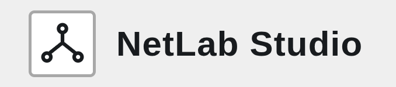
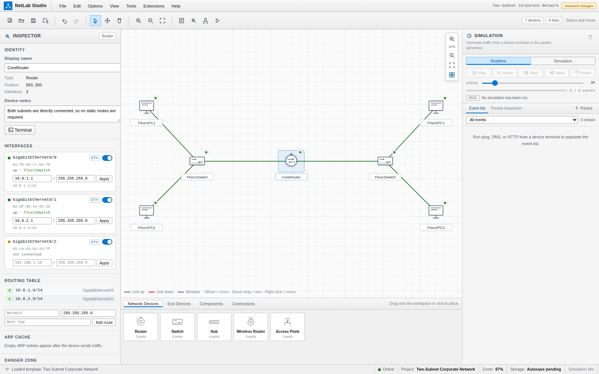
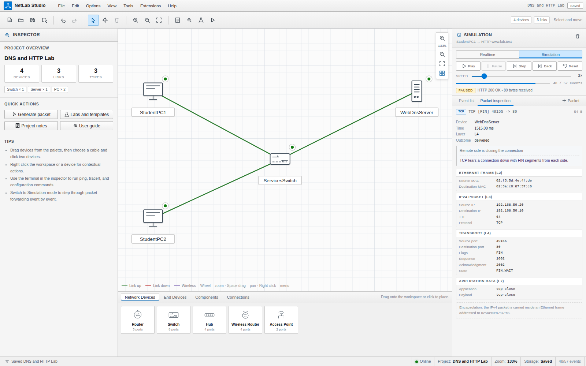
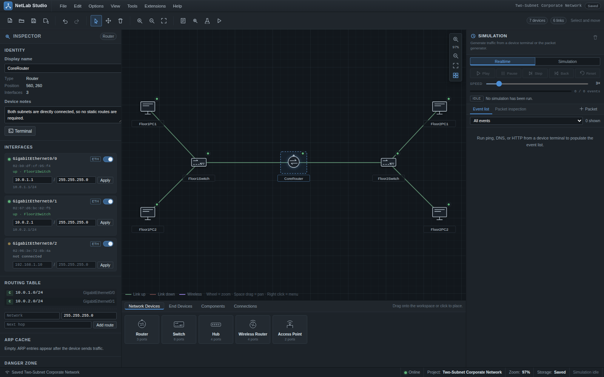

# NetLab Studio

NetLab Studio is a simple network lab tool for learning how networks work. You can drag devices onto a canvas, connect them with cables, set IP addresses, and run things like ping, DNS, and HTTP to see what happens step by step.

It is made by **Advance Tech Club of NIAT** as part of club and college activities. The project is free and open source, so anyone can use it, change it, and improve it.

This tool runs locally. It does not open real network sockets and does not talk to real devices. The networking you see is simulated inside the app for learning.

> NetLab Studio is an independent educational project. It is not connected with Cisco or any other vendor.







## What you can do

- Build topologies with routers, switches, hubs, wireless devices, PCs, laptops, servers, printers, and a patch panel.
- Connect devices with straight-through, crossover, fiber, or wireless links.
- Set IPv4 addresses, masks, gateways, static routes, and basic server services.
- Use realtime or step-by-step simulation to watch events and inspect packets.
- Try the built-in labs, templates, and troubleshooting challenges.
- Use the device terminal for common commands like `ping`, `ipconfig`/`ifconfig`, `show ip route`, `arp -a`, and `show mac address-table`.
- Save projects locally, export/import JSON, and use the app offline after the first load.
- Switch between Light and Dark themes in **Options → Preferences → Appearance**.

## People behind this project

- [@sankirthrbhat](https://github.com/sankirthrbhat)
- [@Druva-Teja03](https://github.com/Druva-Teja03)
- [@kavana-dn](https://github.com/kavana-dn)
- [@yashnikhil93-eng](https://github.com/yashnikhil93-eng)

## Getting started (web)

You need Node.js 22+ and npm.

```bash
npm ci
npm run dev
```

Then open `http://localhost:5173`.

To make a production build:

```bash
npm run build
npm run preview
```

## Desktop app (no browser tab needed)

There is also an Electron desktop build. After building, you get installers/packages in `release/`.

```bash
npm run desktop:dist:deb    # Linux .deb
npm run desktop:dist:win    # Windows .exe (NSIS)
npm run desktop:dist        # both
```

Install the `.deb` on Debian/Ubuntu with:

```bash
sudo apt install ./release/netlab-studio_1.0.0_amd64.deb
```

On Windows, run the `.exe` installer. The Windows installer may be unsigned, so Windows can show a SmartScreen warning.

## A few notes

- The first web load needs internet so the app can cache itself. After that, it can work offline in a supported browser.
- Projects are saved in browser storage. Export important projects as JSON if you want a backup.
- This is a learning simulator, not a full real-world network stack. Some protocols and edge cases are simplified on purpose.

## Tests

```bash
npm run typecheck
npm test
npm run build
npx playwright install chromium
npm run test:e2e
```

## Contributing

If you are from the club or just want to help, feel free to improve the project. Fix bugs, add labs, improve the UI, or make the simulator clearer for students. Try to keep changes working and run the checks before sharing them.

## License

Free and open source under the **Advance Tech Club Open License**. See [LICENSE](LICENSE).
Anyone is welcome to use it, modify it, and make it better as part of learning and college/club activities.

## Docs

More details are in the `docs/` folder:

- [Architecture](docs/ARCHITECTURE.md)
- [Network engine](docs/NETWORK_ENGINE.md)
- [Simulation](docs/SIMULATION.md)
- [Project format](docs/PROJECT_FORMAT.md)
- [Offline support](docs/OFFLINE_SUPPORT.md)
- [Contributing](docs/CONTRIBUTING.md)
